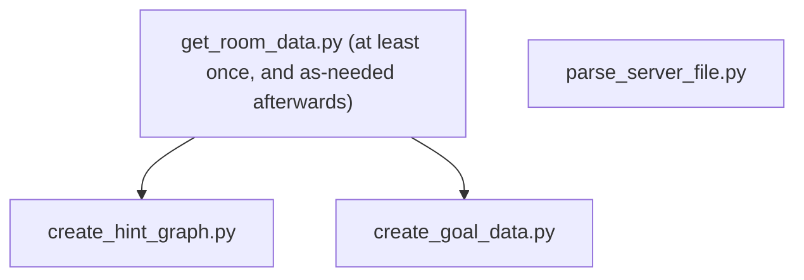

# AP Data Scripts

Some scripts to help me learn python. Used to look at Archipelago data

Click on the links to go to a detailed description of that script
- [`get_room_data.py`](#get_room_datapy) - Gets data for an Archipelago room and stores to json  
- [`create_hint_graph.py`](#create_hint_graphpy) - Creates a hint graph from room data. Has a good number of options to show the data in different ways
  - Disclaimers
    - Hint chains can be misleading since it depends on players hinting in the first place
    - Loops can artificially inflate the number of nodes
- [`create_goal_data.py`](#create_goal_datapy) - Creates goal data json file from room data. Only supports some games
- [`parse_server_file.py`](#parse_server_filepy) - Parses a `.archipelago` server file and prints some info from it

Run each python script with the `-h` or `--help` argument to see what you can do
```bash
python get_room_data.py -h
# A bunch of text will follow here detailing the arguments the script accepts
```

Typical order of how to run scripts


# Setup

### First time setup
```bash
# Install python 3.13 or below (unsure what the lowest version of python is supported)

# Clone this repository with submodules (you can use whatever git/github client you want to do this)
git clone https://github.com/lammyson/AP-Data-Scripts.git --recurse-submodules

# Linux only. Look up your specific package manager if you don't use apt
sudo apt install build-essential graphviz libgraphviz-dev libgvplugin-neato-layout-dev libgvplugin-gd-dev libgvplugin-pango-dev

# Create a python virtual environment
python -m venv .venv

# Start the virtual environment
source .venv/bin/activate # bash
.\.venv\Scripts\Activate.ps1 # powershell

# Upgrade pip
pip install --upgrade pip

# Install python dependencies. Use the file that matches your OS
pip install -r requirements_linux.txt
pip install -r requirements_windows.txt
pip install -r requirements_macos.txt
```

### Every time you open a new terminal after the first time setup is complete
```bash
source .venv/bin/activate # bash
.\.venv\Scripts\Activate.ps1 # powershell
```

# Scripts
TODO - Generate a personal async and get some examples. Mainly want screenshots of the hint graphs (full graph and a single hint chain) and possibly parsing of the server file

## [`get_room_data.py`](get_room_data.py)
Downloads data from an Archipelago webhost that implements the [Webhost API](https://github.com/ArchipelagoMW/Archipelago/blob/main/docs/webhost%20api.md). Required by some of the scripts below

## [`create_hint_graph.py`](create_hint_graph.py)
Creates a hint graph of a room's hints. Graphs all unfound progression hints from all non-goaled slots by default.

### Disclaimers
- Hint chains can be misleading since it depends on players hinting in the first place
- Loops can artificially inflate the number of nodes shown in a hint chain

Depends on [`get_room_data.py`](#get_room_datapy)

## [`create_goal_data.py`](create_goal_data.py)
Outputs goal data in a more human readable format. Only supports a few games

Depends on [`get_room_data.py`](#get_room_datapy)

## [`parse_server_file.py`](parse_server_file.py)
Parses the `*.archipelago` file that's part of a multiworld generation's output and outputs a bunch of data from that file

# Credits
- [Archipelago](https://archipelago.gg) - [source](https://github.com/ArchipelagoMW/Archipelago)
- [beautifulsoup](https://pypi.org/project/beautifulsoup4)
- [httpx](https://pypi.org/project/httpx)
- [pygraphviz](https://pypi.org/project/pygraphviz)
- [tabulate](https://pypi.org/project/tabulate)
